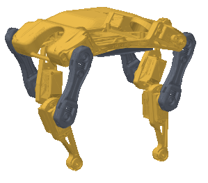

# Hi, I'm Abdulhamid Baghdadi 👋

I work at the intersection of **robotics, mechatronics and software**: robot kinematics and simulation in ROS, search and AI in logic programming, and browser tools that make research work reproducible.

**Tech:** C++ · Python · Java · JavaScript · KiCad · ROS · SysML

---

## Featured projects

<table>
<tr>
<td width="240" valign="middle" align="center">

</td>
<td valign="top">
<h3><a href="https://github.com/UA-ProductDevelopment-TDD/Bittle_Studio">Bittle Studio</a> · UAntwerp Product Development (TDD)</h3>
Design, simulate and send motions to a Petoi Bittle robot dog. It has a pose-by-pose motion timeline, a 3D PyBullet physics simulation that runs the firmware's own skills, and a Bluetooth console for the real robot that explains every serial command in plain language. Motions export as shareable packs or Python scripts. I'm the main developer (42 of 48 commits). <a href="https://ua-productdevelopment-tdd.github.io/Bittle_Studio/">Live robot console →</a> 
<b>Python · PyBullet · 3D web viewer · Web Bluetooth · robotics education</b>
</td>
</tr>
</table>

<table>
<tr>
<td width="50%" valign="top">

<h3><a href="https://github.com/Abdulhamid-Baghdadi/scoping-review-workbench">Scoping Review Workbench</a></h3>
A browser app that guides a PRISMA-ScR scoping review from the first idea to the report. Every review stays a plain folder on your own PC. <a href="https://abdulhamid-baghdadi.github.io/scoping-review-workbench/">Live demo →</a> 
<b>JavaScript · offline browser app · Obsidian</b>
</td>
<td width="50%" valign="top">

<h3><a href="https://github.com/Abdulhamid-Baghdadi/claude-git-graph">git-graph: a Claude Code mod</a></h3>
Adds two panes to the Claude desktop app: a commit graph of the current repo (branch lanes, worktrees, commit and push) and a portfolio with one activity card per local project. It runs local git only, and its tests run against a mocked engine. 
<b>TypeScript · TSX · SVG rendering · Claude Code mod API</b>
</td>
</tr>
<tr>
<td width="50%" valign="top">

<h3><a href="https://github.com/Abdulhamid-Baghdadi/double-scara-robot-ros">Double SCARA Robot (ROS)</a></h3>
Five-bar parallel robot: forward and inverse kinematics, a Shapely collision checker, URDF + RViz simulation, and an Arduino <code>rosserial</code> bridge to the real servos. 
<b>C++ · Python · ROS Melodic · Arduino</b>
</td>
<td width="50%" valign="top">

<h3><a href="https://github.com/Abdulhamid-Baghdadi/megaminx-solver-prolog">Megaminx Solver (Prolog)</a></h3>
Solves the 12-faced Megaminx puzzle with a staged breadth-first search over 116 sub-goals and macro operators that encode human algorithms. Now with a 3D web GUI that runs the solver in the browser. <a href="https://abdulhamid-baghdadi.github.io/megaminx-solver-prolog/">Live demo →</a> 
<b>Prolog · search algorithms · JavaScript · Three.js</b>
</td>
</tr>
<tr>
<td colspan="2" valign="top">
<h3><a href="https://github.com/Abdulhamid-Baghdadi/library-studio">Library Studio</a></h3>
A workbench for a publication library kept as Obsidian notes: topic clusters (TF-IDF + Leiden consensus clustering), a citation network from OpenAlex, metadata enrichment, and export to Excel and BibTeX. <a href="https://abdulhamid-baghdadi.github.io/library-studio/">Live demo →</a> 
<b>JavaScript · graph algorithms · OpenAlex API</b>
</td>
</tr>
</table>
