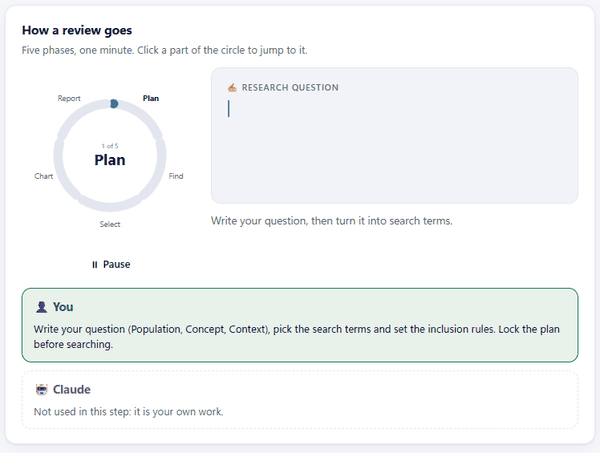

# Hi, I'm Abdulhamid Baghdadi 👋

I work at the intersection of **robotics, mechatronics and software**: robot kinematics and simulation in ROS, search and AI in logic programming, and browser tools that make research work reproducible.

**Tech:** C++ · Python · Java · JavaScript · KiCad · ROS · SysML

---

## Featured projects

<table>
<tr>
<td width="240" valign="middle" align="center">

</td>
<td valign="top">
<h3><a href="https://github.com/UA-ProductDevelopment-TDD/Bittle_Studio">Bittle Studio</a> · UAntwerp Product Development (TDD)</h3>
Design, simulate and send motions to a Petoi Bittle robot dog. It has a pose-by-pose motion timeline, a 3D PyBullet physics simulation that runs the firmware's own skills, and a Bluetooth console for the real robot that explains every serial command in plain language. Motions export as shareable packs or Python scripts. I'm the main developer (42 of 48 commits). <a href="https://ua-productdevelopment-tdd.github.io/Bittle_Studio/">Live robot console →</a> 
<b>Python · PyBullet · 3D web viewer · Web Bluetooth · robotics education</b>
</td>
</tr>
</table>

<table>
<tr>
<td width="50%" valign="top">

<h3><a href="https://github.com/Abdulhamid-Baghdadi/kicad-jlcpcb-part-picker">KiCad JLCPCB Part Picker</a></h3>
A KiCad add-on: search JLCPCB/LCSC parts in an EasyEDA-style picker from the PCB and schematic editors, import symbol, footprint and 3D model into your library (checked pin to pad), and place the part on the board or schematic. <a href="https://github.com/Abdulhamid-Baghdadi/kicad-jlcpcb-part-picker/releases/latest">Download →</a> 
<b>Python · KiCad plugin + IPC API · wxPython · easyeda2kicad</b>
</td>
<td width="50%" valign="top">

<h3><a href="https://github.com/Abdulhamid-Baghdadi/scoping-review-workbench">Scoping Review Workbench</a></h3>
A browser app that guides a PRISMA-ScR scoping review from the first idea to the report. Every review stays a plain folder on your own PC. <a href="https://abdulhamid-baghdadi.github.io/scoping-review-workbench/">Live demo →</a> 
<b>JavaScript · offline browser app · Obsidian</b>
</td>
</tr>
<tr>
<td width="50%" valign="top">

<h3><a href="https://github.com/Abdulhamid-Baghdadi/double-scara-robot-ros">Double SCARA Robot (ROS)</a></h3>
Five-bar parallel robot: forward and inverse kinematics, a Shapely collision checker, URDF + RViz simulation, and an Arduino <code>rosserial</code> bridge to the real servos. 
<b>C++ · Python · ROS Melodic · Arduino</b>
</td>
<td width="50%" valign="top">

<h3><a href="https://github.com/Abdulhamid-Baghdadi/megaminx-solver-prolog">Megaminx Solver (Prolog)</a></h3>
Solves the 12-faced Megaminx puzzle with a staged breadth-first search over 116 sub-goals and macro operators that encode human algorithms. Now with a 3D web GUI that runs the solver in the browser. <a href="https://abdulhamid-baghdadi.github.io/megaminx-solver-prolog/">Live demo →</a> 
<b>Prolog · search algorithms · JavaScript · Three.js</b>
</td>
</tr>
<tr>
<td width="50%" valign="top">

<h3><a href="https://github.com/Abdulhamid-Baghdadi/robot-milling-dust-extractor">Robot Milling Dust Extractor</a></h3>
A motorised dust and chip extractor for a KUKA robot milling cell. The robot sets the inlet height to match the tool length, and load cells make it stop or retract on collision. Solo master's project: SolidWorks design, 3D printing, electronics and ESP32/Arduino firmware. 
<b>ESP32 · Arduino · HX711 load cells · SolidWorks · Eagle</b>
</td>
<td width="50%" valign="top">
<h3><a href="https://github.com/Abdulhamid-Baghdadi/library-studio">Library Studio</a></h3>
A workbench for a publication library kept as Obsidian notes: topic clusters (TF-IDF + Leiden consensus clustering), a citation network from OpenAlex, metadata enrichment, and export to Excel and BibTeX. <a href="https://abdulhamid-baghdadi.github.io/library-studio/">Live demo →</a> 
<b>JavaScript · graph algorithms · OpenAlex API</b>
</td>
</tr>
<tr>
<td width="50%" valign="top">

<h3><a href="https://github.com/Abdulhamid-Baghdadi/robot-kinematics-four-robots">Robot Kinematics: Four Small Robots</a></h3>
Closed-form forward and inverse kinematics for a five-bar, a delta, an articulated arm and a SCARA robot from a 2021 team project. Ported to Python 3, with round-trip tests (which found and fixed two IK bugs) and an animation per robot. <a href="https://abdulhamid-baghdadi.github.io/robot-kinematics-four-robots/">Interactive demo →</a> 
<b>Python · kinematics · pytest · matplotlib</b>
</td>
<td width="50%" valign="top">

<h3><a href="https://github.com/Abdulhamid-Baghdadi/turtlebot-maze-chase">TurtleBot Maze Chase (ROS + Gazebo)</a></h3>
A hunter TurtleBot chases <i>n</i> robots through a maze: breadth-first search path planning to the nearest prey, prey that flee to another quadrant, and caught robots removed from Gazebo. Team project with Moritz Abdank. 
<b>C++ · ROS Melodic · Gazebo · path planning</b>
</td>
</tr>
<tr>
<td width="50%" valign="top">

<h3><a href="https://github.com/Abdulhamid-Baghdadi/claude-git-graph">git-graph: a Claude Code mod</a></h3>
Adds two panes to the Claude desktop app: a commit graph of the current repo (branch lanes, worktrees, commit and push) and a portfolio with one activity card per local project. It runs local git only, and its tests run against a mocked engine. 
<b>TypeScript · TSX · SVG rendering · Claude Code mod API</b>
</td>
<td width="50%" valign="top">

<h3><a href="https://github.com/Abdulhamid-Baghdadi/kalman-ekf-wheeled-robot">Kalman vs. Extended Kalman Filter (ROS + Gazebo)</a></h3>
Pose estimation for a wheeled ROSbot: a linear KF and an EKF linearised with Jacobians fuse velocity commands with noisy odometry, running side by side in Gazebo and RViz. The recording also shows where both struggle: at corners, where the motion model doesn't match the robot. Jacobians derived in MATLAB; Docker setup reproduces the video. Solo master's project. 
<b>C++ · Eigen · ROS Noetic · Gazebo · MATLAB</b>
</td>
</tr>
<tr>
<td width="50%" valign="top">

<h3><a href="https://github.com/Abdulhamid-Baghdadi/two-mass-oscillator-modsim">Two-Mass Oscillator: Multibody Simulation</a></h3>
Pendulum on a spring-suspended mass: a 2-DOF multibody model derived with Newton and Lagrange, built in Simulink and Simscape Multibody, and reproduced in Python (sympy/scipy). Group project, FH Wiener Neustadt. 
<b>MATLAB · Simscape · Python · Multibody dynamics</b>
</td>
<td width="50%" valign="top">

<h3><a href="https://github.com/Abdulhamid-Baghdadi/eda-format-converter">EDA Format Converter</a></h3>
Converts PCB boards, symbols and footprints between KiCad, Eagle and EasyEDA in any direction, with source and result previewed side by side and a report of anything approximated. Runs in the browser, so no files are uploaded. Checked with KiCad's own DRC and Eagle importer. <a href="https://abdulhamid-baghdadi.github.io/eda-format-converter/">Live app →</a> 
<b>TypeScript · Vite · SVG · KiCad / Eagle / EasyEDA formats · Vitest</b>
</td>
</tr>
</table>
